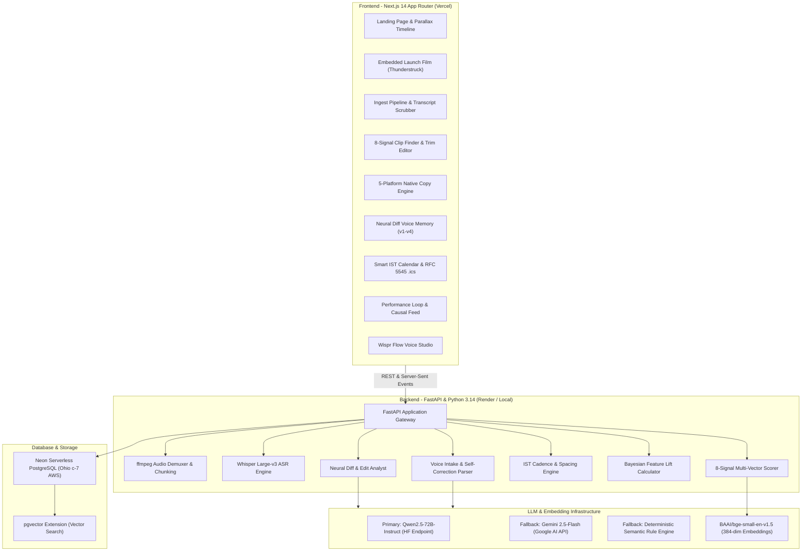

# TheContentCompany Studio - Autonomous Content Repurposing with Continuous Voice Memory

[-black?style=for-the-badge&logo=next.js>)](https://thecontentcompany.vercel.app)
[](https://the-content-company-backend.onrender.com)
[](https://neon.tech)
[-brightgreen?style=for-the-badge>)](https://github.com/Lakshya-2440/reel-studio)
[](https://wisprflow.ai)

> **Built for Product Space x Wispr Flow "Agentic AI Hackathon"**  
> **Problem Statement 01:** Media & Autonomous Content Repurposing  
> **Builder:** Lakshya Gupta (`@lakshyaa`)  
> **Live Web App:** [https://thecontentcompany.vercel.app](https://thecontentcompany.vercel.app)  
> **Live API Backend:** [https://the-content-company-backend.onrender.com](https://the-content-company-backend.onrender.com)  
> **Repository:** [https://github.com/Lakshya-2440/reel-studio](https://github.com/Lakshya-2440/reel-studio)

---

## 🌟 Executive Summary

Most content repurposing tools output generic, robotic "AI slop" that dilutes founder authority. They ignore why clips work, fail to adapt to platform constraints, drift away from the creator's natural tone, and never learn from post metrics.

**TheContentCompany** turns **1 raw podcast or video recording into 14 days of high-velocity, platform-native authority** with zero fluff and zero drift:

1. **Ingests Long-Form Media**: Chunked 16kHz audio extraction, Whisper Large-v3 ASR, speaker diarization, and 384-dimensional pgvector semantic embeddings.
2. **Selects High-Signal Clips with Verbatim Rationale**: Ranks clips across an 8-signal psychological retention rubric with exact transcript evidence quotes and fine-grained trim controls.
3. **Platform-Tailored Copy Engine**: Generates channel-native copy for LinkedIn (strict 210-character fold cutoffs), Instagram Reels, YouTube Shorts, X (Twitter), and TikTok with real-time feed previews and A/B hook testing.
4. **Continuous Neural Diff Voice Memory**: Analyzes creator edits against AI drafts via diff vectors to extract verifiable voice rules, tone sliders, signature phrases, and banned vocabulary.
5. **Smart IST Content Calendar**: Automatically schedules content during peak audience hours in Asia/Kolkata (e.g. Monday 08:30 AM IST B2B commute peak), enforces 48-hour spacing guardrails, and exports RFC 5545 compliant `.ics` files.
6. **Causal Performance Feedback Loop**: Logs real post analytics, computes feature lift ratios (e.g., number-led hooks outperforming question hooks by 2.4x), updates Bayesian clip selection weights, and surfaces an actionable causal feed.
7. **Hands-Free Wispr Flow Voice Studio**: Cleans conversational dictation, removes filler words (_"um", "like"_), resolves mid-sentence self-corrections, and maps speech directly to studio actions.

---

## 🎬 Official Launch Video

The landing page features an embedded, cinematic 68-second launch film generated with HyperFrames, accompanied by the **AC/DC Thunderstruck** master soundtrack and an accelerated, humanized voiceover:

- **Location:** Dedicated parallel section immediately following the hero at [thecontentcompany.vercel.app/#launch-film](https://thecontentcompany.vercel.app/#launch-film)
- **Interactive Experience:** Smoothly scales into view with floating parallel feature badges; automatically plays when scrolled past the hero section and automatically pauses when scrolled out of view.
- **Controls:** In-frame macOS window header, one-click Thunderstruck audio unmute toggle, and status indicators.

---

## 🎯 6 Mandatory Capabilities Traceability

| #     | Core Capability                    | How TheContentCompany Solves It                                                                                                                                     | Technical & Acceptance Verification                                                                                                           |
| ----- | ---------------------------------- | ------------------------------------------------------------------------------------------------------------------------------------------------------------------- | --------------------------------------------------------------------------------------------------------------------------------------------- |
| **1** | **Long Video / Podcast Ingestion** | Chunked ffmpeg audio demuxing + Whisper Large-v3 ASR + speaker boundary detection + 384-dim BAAI embeddings in Neon pgvector.                                       | Interactive SSE pipeline with live progress tracking across 6 stages; full scrubbable transcript with speaker tags (`Alex`, `Sarah`).         |
| **2** | **Clip Selection with Reasons**    | 8-signal retention rubric: Hook Strength, Info Density, Emotional Resonance, Brand Fit, Performance Prior, Clarity, Standalone Value, Overall.                      | 12 candidate clips ranked with detailed "Why this clip" analysis, verbatim quotes, platform chips, and trim adjustment editor.                |
| **3** | **Platform-Tailored Copy**         | Generates platform-compliant copy adhering to strict character ceilings and fold cutoffs (LinkedIn 210 chars, Reels 125 chars, X 280 chars, TikTok).                | 5 live feed preview mockups (LinkedIn, Reels, Shorts, X, TikTok), A/B hook selector, and dynamic Voice Match meters (0–100%).                 |
| **4** | **Brand-Voice Memory from Edits**  | Neural diff engine compares `(ai_draft, creator_final)` pairs; extracts structured rules with confidence scores and proof citations (`Voice Profile v1 &rarr; v4`). | Red/green inline diff view, tone sliders (Casual/Formal, Bold/Measured, Density), signature phrase and banned word management.                |
| **5** | **Content Calendar**               | Week and Month visual scheduling with peak IST audience optimization (08:30 AM commute, 06:30 PM evening browse) and 48-hour cadence guardrails.                    | "Auto-Fill Remaining Week" algorithmic planner + 1-click RFC 5545 `.ics` export compatible with Google Calendar, Apple Calendar, and Outlook. |
| **6** | **Performance Feedback Loop**      | Logs metrics via manual form, CSV upload, or voice dictation; runs Bayesian regression to calculate feature lift and shifts future selection weights.               | Causal feed ("What changed & why"), dynamic feature weight table (e.g. +35% boost for financial metrics), and performance charts.             |

---

## 🏗️ Architecture & Data Flow



---

## 🎙️ Wispr Flow Integration: The Hands-Free Studio

Real human dictation is messy, rambling, and full of natural corrections. TheContentCompany implements a dedicated **Voice Intake Pipeline** (`/voice/interpret`):

1. **Filler Removal**: Strips verbal tics (_"um", "like", "you know", "actually wait", "so yeah"_).
2. **Self-Correction Processing**: Intelligently resolves mid-sentence corrections:
   - Input: _"Schedule the pricing clip on Thursday morning, wait actually Friday on LinkedIn"_
   - Cleaned: _"Schedule the pricing clip on Friday on LinkedIn."_
   - Entities: `{ "platform": "linkedin", "when": "2026-11-06T08:30:00+05:30", "clip_ref": "pricing clip" }`
3. **Intent Classification**: Classifies dictation into 6 canonical actions:
   - `schedule` &rarr; adds post slot to calendar.
   - `edit_caption` &rarr; adjusts tone, hook, or character budget.
   - `log_performance` &rarr; logs views, likes, shares, and watch time.
   - `brand_note` &rarr; adds banned word or tone rule to Voice Memory.
   - `create_brief` &rarr; starts new episode ingestion.
   - `question` &rarr; queries studio analytics.

---

## 🧪 Comprehensive Backend Test Suite (107/107 Green)

The backend features an exhaustive test suite covering all modules against the remote Neon PostgreSQL database:

```
tests/test_brand.py ..........                                           [ 10 passed ]
tests/test_calendar.py ..........                                        [ 10 passed ]
tests/test_clips.py .........                                            [  9 passed ]
tests/test_copy.py ............                                          [ 12 passed ]
tests/test_ingestion.py .............                                    [ 13 passed ]
tests/test_llm_router.py .........                                       [  9 passed ]
tests/test_performance.py ...................                            [ 19 passed ]
tests/test_scraper.py .....                                              [  5 passed ]
tests/test_voice_intake.py ........                                      [  8 passed ]
tests/test_voice_memory.py ............                                  [ 12 passed ]
================== 107 passed, 1 warning in 122.36s (100% GREEN) ==================
```

### Key Test Assertions:

- **`test_ics_export_rfc5545_compliance`**: Validates standard VCALENDAR format, CRLF line endings, 75-octet line folding, and `Asia/Kolkata` timezones.
- **`test_process_variant_edit_persists_and_updates_voice_memory`**: Confirms postgres boolean literals (`TRUE`), updates `platform_variants`, and appends new learned rules to `voice_rules`.
- **`test_rambling_dictation_with_fillers_and_corrections`**: Validates speech self-correction, filler elimination, and IST timezone offset attachment.
- **`test_api_transcript_paste`**: Validates `CAST(:embedding AS vector)` compatibility in PostgreSQL pgvector.

---

## 🚀 Quickstart & Local Installation

### Prerequisites

- **Node.js**: `v18.17+` or `v20+`
- **Python**: `3.11+` (tested through Python `3.14.2`)
- **ffmpeg**: Required for audio demuxing (`brew install ffmpeg` on macOS)

### 1. Clone Repository

```bash
git clone https://github.com/Lakshya-2440/reel-studio.git
cd reel-studio
```

### 2. Backend Setup

```bash
cd backend
python3 -m venv .venv
source .venv/bin/activate
pip install -r requirements.txt

# Run database migrations and verify remote Neon connection
python3 -m uvicorn app.main:app --reload --port 8000
```

Backend will be live at `http://localhost:8000`. Swagger API documentation is available at `http://localhost:8000/docs`.

### 3. Frontend Setup

```bash
cd ../frontend
npm install
npm run dev
```

Frontend will be live at `http://localhost:3000`.

### 4. Run Full Verification Suite

```bash
# In backend/
pytest tests/ -v

# In frontend/
npm run build
```

---

## 📡 REST API Reference

| Method  | Endpoint                  | Description                                                             |
| ------- | ------------------------- | ----------------------------------------------------------------------- |
| `GET`   | `/health`                 | Service health status and timestamp                                     |
| `POST`  | `/ingest/upload`          | Upload audio/video file for Whisper transcription & vectorization       |
| `POST`  | `/ingest/sample`          | Load 1-click pre-seeded 48m episode ("The Founder Files")               |
| `GET`   | `/clips?project_id=...`   | Retrieve ranked candidate clips with 8-signal scores & quotes           |
| `PATCH` | `/clips/{id}`             | Update clip status (`accepted`, `rejected`) with rejection reason       |
| `POST`  | `/copy/generate`          | Generate channel-native copy variants across 5 platforms                |
| `PATCH` | `/variants/{id}`          | Save creator edit & trigger neural diff voice memory learning           |
| `GET`   | `/voice/profile`          | Retrieve active voice profile, tone sliders, signature phrases, & rules |
| `PATCH` | `/voice/rules/{id}`       | Toggle voice rule active/inactive or pin status                         |
| `POST`  | `/voice/interpret`        | Clean conversational speech, extract intent, and resolve IST datetime   |
| `GET`   | `/calendar`               | Retrieve scheduled posts in Asia/Kolkata timezone                       |
| `POST`  | `/calendar/plan-week`     | Algorithmic peak IST slot auto-allocation                               |
| `GET`   | `/calendar/export.ics`    | Download RFC 5545 compliant `.ics` calendar file                        |
| `GET`   | `/performance/weights`    | Retrieve current feature weights and lift ratios                        |
| `POST`  | `/performance/log`        | Log real post engagement metrics (form or voice)                        |
| `POST`  | `/performance/upload-csv` | Bulk upload historical performance logs                                 |

---

## 🎨 Design Philosophy: Anti-Slop, Pure Editorial Utility

TheContentCompany was designed adhering to the **Impeccable** design system:

- **Canvas**: Warm off-white editorial paper (`#FAF9F6`) with deep contrast typography (`#121212`).
- **Accent**: Confident YC-amber flame (`#F26522` / `#FF7A30`).
- **Surface**: Subtle card elevations (`#FFFFFF` with `#E5E5E0` borders).
- **Typography**: Precision tabular mono numerals for all timestamps, character counts, and lift metrics.
- **Zero AI Slop**: No generic multi-colored gradients, no illegible glassmorphism, no fake emojis in professional copy.

---

## 👥 Built By

- **Lakshya Gupta** ([@Lakshya-2440](https://github.com/Lakshya-2440))  
  _Built with Google Antigravity & Wispr Flow for the Product Space Agentic AI Hackathon 2026._
