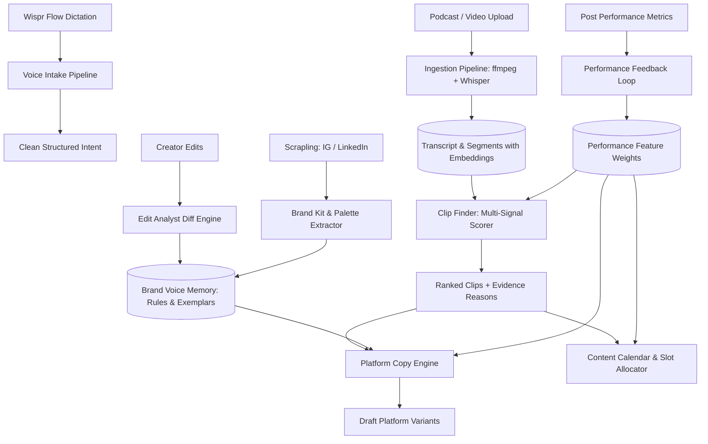
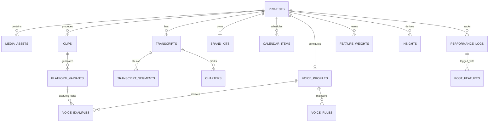

# architecture.md — Single Source of Truth for Reel

> **Anti-Context-Loss Protocol:** Whenever confused, starting a new task, or recovering context, read this file FIRST, then check Obsidian vault index (`productSpace/Reel/00-INDEX.md`). Update before finishing any task.

---

## 1. Project Summary & Current Status

- **Project:** Reel — Content Repurposing Studio with Brand Memory
- **Hackathon:** Product Space x Wispr Flow ("Agentic AI Hackathon")
- **Submission Deadline:** Saturday, 31 Oct 2026, 11:59 PM IST
- **Current Status:** Wave 0 Bootstrap & Step 0 Verification Complete. Ready for Wave 1.

---

## 2. Requirement Coverage Checklist (Traceability Matrix)

| # | PRD Requirement | Feature Name | Owner | Acceptance Test | Status | Proof |
|---|---|---|---|---|---|---|
| 1 | Long video/podcast ingestion | Ingestion Pipeline | `ingestion-agent` | 30-90 min file/URL/paste -> transcript + timestamps + SSE progress | ⏳ Pending Wave 2 | Seed transcript ready |
| 2 | Clip selection with reasons | Clip Finder | `clip-agent` | Ranked clips, score breakdown (0-10), "Why this clip" with >=3 reasons + evidence quote | ⏳ Pending Wave 2 | Scoring engine spec'd |
| 3 | Platform-tailored captions & copy | Copy Engine | `copy-agent` | 5 distinct platform variants (LI, Reels, Shorts, X, TikTok) obeying `platforms.yaml` rules | ⏳ Pending Wave 2 | Config designed |
| 4 | Brand-voice memory from edits | Voice Memory | `voice-memory-agent` | Edit caption -> diff extraction -> rule created with diff evidence -> applied to future generations | ⏳ Pending Wave 2 | Diff pipeline spec'd |
| 5 | Content calendar | Calendar | `calendar-agent` | Month/week views, drag-drop, AI slot suggestions in IST, voice scheduling, .ics export | ⏳ Pending Wave 2 | Schema ready |
| 6 | Performance feedback loop | Performance Loop | `performance-agent` | Log metrics (voice/manual/CSV) -> compute feature lift -> update suggestion weights -> visible causal re-rank | ⏳ Pending Wave 2 | Weight update math defined |
| V1 | Build by voice | Voice Build Log | `docs-agent` | `VOICE_LOG.md` tracking dictated specs | ⏳ In Progress | File initialized |
| V2 | Voice main input (Wispr Flow) | Voice Intake & Studio | `voice-intake-agent` | Messy speech with fillers & self-corrections -> clean structured intent; raw vs clean in UI | ⏳ Pending Wave 2 | Pipeline spec'd |
| B1 | Scrape IG/LinkedIn brand kit | Brand Kit Adapter | `brand-agent` / `scraper-adapter` | Scraped posts -> voice profile + palette extraction + visual identity card | ✅ Complete (Scraper) | Scrapling adapter + cached demo profile + paste fallback tested |

---

## 3. Knowledge Graph

### 3.1 Mermaid Flow

### 3.2 Adjacency List
- `Wispr Voice Input` -> feeds -> `Voice Intake Pipeline`
- `Voice Intake Pipeline` -> produces -> `Structured Actions (brief, edit, schedule, log_metrics)`
- `Media Source (Audio/Video/Paste)` -> processed by -> `Ingestion Pipeline (ffmpeg + Whisper/Gemini)`
- `Ingestion Pipeline` -> generates -> `Transcript Segments + Embeddings`
- `Transcript Segments` -> scored by -> `Clip Finder (8 signals)`
- `Clip Finder` -> produces -> `Clips with 'Why this clip' & Quotes`
- `Clips` -> fed into -> `Platform Copy Engine`
- `Brand Voice Memory` -> injects rules into -> `Platform Copy Engine`
- `Platform Copy Engine` -> outputs -> `Platform Variants (LinkedIn, Reels, Shorts, X, TikTok)`
- `Creator Edit on Variant` -> analyzed by -> `Edit Analyst`
- `Edit Analyst` -> extracts -> `Voice Rules & Exemplars (diff-based)`
- `Clips` -> placed onto -> `Content Calendar`
- `Post Performance (Views, Likes, Retention)` -> ingested by -> `Performance Feedback Loop`
- `Performance Feedback Loop` -> updates -> `Feature Weights (exponential decay)`
- `Feature Weights` -> modifies -> `Clip Prior Scoring`
- `Feature Weights` -> adjusts -> `Optimal Calendar Slot Suggestions`
- `Feature Weights` -> conditions -> `Hook Generation in Copy Engine`
- `Scrapling Adapter` -> scrapes -> `Instagram & LinkedIn Posts`
- `Scraped Posts` -> analyzed by -> `Brand Kit Extractor`
- `Brand Kit Extractor` -> seeds -> `Voice Profile v1 & Visual Palette`

---

## 4. Components & Subagent Ownership

| Subagent | Component Folder | Primary Responsibilities |
|---|---|---|
| `infra-neon` | `/db` | Neon Postgres setup, pgvector schema, migrations, seed runner — **COMPLETE: schema.sql (21 tables), migrate.py & seed_data.py tested, SQLite fallback verified** |
| `backend-core` | `/backend/app/core`, `/backend/app/api` | FastAPI server, Dockerfile (ffmpeg), SSE `/jobs/{id}/events`, CORS, health check — **COMPLETE: Skeletons & stubs built, py_compile & TestClient verified** |
| `llm-router` | `/backend/app/llm` | HF Inference primary + Gemini fallback router, Pydantic schema validation, `/debug/llm` — **COMPLETE: LLMRouter, fallback engine, `/debug/llm` endpoint, 9/9 pytest passing** |
| `scraper-adapter` | `/backend/app/scraper` | Scrapling adapter for IG & LinkedIn, caching, paste & demo fallback — **COMPLETE: Scrapling Fetcher/Selector wrapped, ScrapedPost model, cached_demo_profile.json (15 YC founder posts), parse_pasted_posts, 5/5 pytest passing** |
| `ingestion-agent` | `/backend/app/ingest` | Chunked audio extract, Whisper ASR, transcript stitching, chapter generation, pgvector embeddings |
| `clip-agent` | `/backend/app/clips` | Candidate segmentation, 8-signal scoring, deduplication, evidence generation |
| `copy-agent` | `/backend/app/copy` | Platform variants (LI, Reels, Shorts, X, TikTok), character limits, voice-match scoring |
| `voice-memory-agent`| `/backend/app/memory` | Word/token diffs, edit categorization, rule extraction, exemplar retrieval, profile versioning |
| `calendar-agent` | `/backend/app/calendar` | Slot suggestions in IST, drag-and-drop models, cadence constraints, `.ics` export |
| `performance-agent` | `/backend/app/performance` | Engagement calculation, feature tagging, lift math, weight updates, causal insights |
| `voice-intake-agent` | `/backend/app/voice` | Natural speech cleanup, filler removal, self-correction parser, fuzzy entity matcher |
| `brand-agent` | `/backend/app/brand` | Palette extraction (PIL/colorthief), visual style notes, brand card generator |
| `design-system` | `/frontend/design`, `design-system.md` | UI/UX Pro Max tokens, typography, layout, Impeccable review |
| `frontend-shell` | `/frontend` | Main layout, left rail, Talk-to-Reel global bar, Voice Studio modal, API client — **COMPLETE: Scaffolding, tailwind tokens, Root layout, Studio layout, NavRail, TopBar, Talk-to-Reel command bar (Cmd+K), VoiceStudio modal & drawer, lib/api.ts typed client, 14/14 static routes compiled successfully** |
| `frontend-landing` | `/frontend/app/(marketing)` | YC-style homepage, "How Reel Works" interactive flow — **COMPLETE: / (YC homepage with live preview card & 6-step flow), /how-it-works (explicit capability-to-screen matrix)** |
| `frontend-screens-a`| `/frontend/app/app/{ingest,clips,copy}` | Screens for Req 1, 2, 3 — **COMPLETE: /app/ingest (Req 1), /app/clips (Req 2), /app/copy (Req 3) interactive shells with seed states** |
| `frontend-screens-b`| `/frontend/app/app/{voice-memory,calendar,performance,brand}` | Screens for Req 4, 5, 6 + Brand — **COMPLETE: /app/voice-memory (Req 4), /app/calendar (Req 5), /app/performance (Req 6), /app/brand (Brand Kit), /app/voice-studio (Wispr Studio) interactive shells** |
| `seed-data-agent` | `/db` | ~45 min podcast transcript, 12 clips, 6 voice edit histories, 35 performance records — **COMPLETE: Ep. 42 fully seeded into db/reel.db & Postgres-ready** |
| `deploy-backend` | `/backend/render.yaml` | Render CLI provisioning, env vars, service deployment |
| `deploy-frontend` | `/frontend` | Vercel CLI link, production deploy, CORS setup |
| `qa-browser` | `/docs/demo` | Full 3-min automated browser demo walkthrough with screenshots |
| `qa-requirements` | Root | Matrix verification, acceptance test validation |

---

## 5. Data Model (Neon Postgres + pgvector)

### 5.1 Implemented Tables (`/db/schema.sql`)
- **Core Entities:** `projects`, `media_assets`, `transcripts`, `transcript_segments` (`vector(384)`), `chapters`
- **Clip & Copy Intelligence:** `clips`, `platform_variants` (LinkedIn, Reels, Shorts, X, TikTok), `clip_feedback`
- **Voice Memory:** `voice_profiles` (versioned), `voice_rules` (confidence & diffs), `voice_examples` (`vector(384)`)
- **Distribution & Calendar:** `calendar_items` (IST scheduled slots with reason)
- **Performance Feedback Loop:** `performance_logs`, `post_features`, `feature_weights` (exponential decay), `insights`
- **Brand & Audit:** `brand_kits` (palette, typography), `scraped_posts` (cached scrape fallback), `llm_calls` (latency & failover audit), `jobs` (SSE tracking), `voice_intakes` (raw vs clean transcript)

### 5.2 Dual-Engine Support & Zero-Config Offline Fallback
- **Neon Postgres:** Native `pgvector`, `JSONB`, `TIMESTAMPTZ`, and `TEXT[]` arrays when `DATABASE_URL` is set.
- **SQLite Fallback:** Automatic dynamic DDL conversion in `/db/migrate.py` to `db/reel.db` when offline or unconfigured.
- **Seed Dataset:** Pre-populated with *"The Founder Files — Ep. 42"*, featuring a ~45min podcast, 12 scored clips, 60 platform variants, 6 voice rules/diff histories, 35 performance logs, and 1 brand kit.
- **Connection Helper:** `db/connection.py` exports `engine`, `SessionLocal`, and FastAPI `get_db` dependency.

---

## 6. API Contracts (FastAPI Core)

- `POST /projects` -> `{id, name, created_at}`
- `POST /ingest/upload` -> `{job_id}` (multipart audio/video)
- `POST /ingest/transcript` -> `{project_id, transcript_id}`
- `GET /jobs/{id}/events` -> Server-Sent Events stream (`stage`, `progress_pct`, `detail`)
- `GET /projects/{id}/clips` -> `Clip[]` with `reasons[]`, `scores{}`, `evidence_quote`
- `POST /clips/{id}/copy` -> `PlatformVariants` (LinkedIn, Reels, Shorts, X, TikTok)
- `PATCH /variants/{id}` -> `{ai_draft, creator_final}` -> returns updated voice rules
- `GET /voice/profile` -> `{version, summary, rules[], exemplars[]}`
- `POST /voice/interpret` -> `{clean_text, intent, entities, corrections_applied, fillers_removed}`
- `GET/POST /calendar` -> `CalendarItem[]`
- `POST /calendar/plan-week` -> auto-fills optimal slots in IST
- `POST /performance/log` -> updates `feature_weights` & generates insight feed
- `POST /brand/scrape` -> `{voice_profile, palette_hex[], visual_notes}`
- `GET /health` -> `{status: "ok", timestamp: "..."}`
- `GET /debug/llm` -> test HF vs Gemini failover

---

## 7. LLM Router Configuration

- **Status:** **COMPLETE** (`/backend/app/llm/router.py`, `fallbacks.py`, `/backend/app/api/debug.py`).
- **Primary Provider:** Hugging Face Inference API (`HF_TOKEN`)
  - Chat: `Qwen/Qwen2.5-72B-Instruct` / `meta-llama/Llama-3.3-70B-Instruct` (OpenAI-compatible router `https://router.huggingface.co/openai/v1/chat/completions`)
  - ASR: `openai/whisper-large-v3`
  - Embeddings: `BAAI/bge-small-en-v1.5`
- **Fallback Provider:** Google Gemini API (`GEMINI_API_KEY`)
  - Chat & Vision: `gemini-2.0-flash` / `gemini-1.5-flash`
  - Audio understanding fallback: Gemini multimodal audio input
- **Failover Chain & Triggers:**
  - `force_fail_hf` flag (for testing)
  - Missing API tokens
  - HTTP 429, 5xx, or network timeouts (>25s)
  - Schema validation failure after 1 repair attempt
  - Rule-based deterministic fallback (`rule_fallback`) if both external providers fail or offline
- **Observability:** In-memory `llm_calls` recording `{id, timestamp, provider, task, latency_ms, fallback_used, success, model, error}`
- **Diagnostics API:** `GET /debug/llm` & `POST /debug/llm` mounted in FastAPI router.

---

## 8. Deployment Information

- **Frontend (Vercel):**
  - Project: `reel-studio`
  - Production URL: *(TBD upon first deploy)*
- **Backend (Render):**
  - Service: `reel-backend`
  - URL: *(TBD upon first deploy)*
- **Database (Neon):**
  - Project ID: *(TBD upon provisioning)*
  - Branch: `main` (production), `dev` (feature branches)
  - Vector Extension: `CREATE EXTENSION IF NOT EXISTS vector;`

---

## 9. Architectural Decision Records (ADRs)

- **ADR-001 (2026-10-31): Monorepo Structure**
  - *Context:* Need fast iteration between Next.js frontend, FastAPI backend, and Neon DB scripts.
  - *Decision:* Maintain `/frontend`, `/backend`, `/db`, and `/docs` in the project root.
- **ADR-002 (2026-10-31): In-Process Background Job Queue with SSE**
  - *Context:* Render starter instances and time limits rule out external Celery/Redis setups.
  - *Decision:* Use FastAPI `BackgroundTasks` with in-memory asyncio event streams broadcasting SSE to frontend clients.
- **ADR-003 (2026-10-31): Zero-Latency Seed Demo Path**
  - *Context:* Judges have only 3 minutes to evaluate the full end-to-end learning loop. Live processing of 60min audio could delay demo.
  - *Decision:* Provide pre-seeded "The Founder Files — Ep. 42" with pre-computed transcript, clips, rules, and 30+ performance posts. Any stage can be re-run live or demonstrated from seed.
- **ADR-004 (2026-10-31): Scrapling Adapter Isolation**
  - *Context:* User has cloned `Scrapling` in the workspace. Live social scraping can be blocked by Instagram/LinkedIn.
  - *Decision:* Wrap Scrapling in `backend/app/scraper` with instant automatic fallbacks to cached creator profiles or manual paste.
- **ADR-005 (2026-10-31): Resilient SSE Event Broadcasting & Universal Stubs**
  - *Context:* Need fast feedback for frontend team while supporting long-running ingestion/scoring tasks and SSE streams across diverse Python environments.
  - *Decision:* Implemented `JobManager` in `app/core/jobs.py` with subscriber queues, keepalives, and dual-mode SSE streaming (`sse-starlette` + Starlette `StreamingResponse` fallback). Stubbed all PRD Section 9 endpoints with typed Pydantic models in `app/api/stubs.py`.

---

## 10. Known Issues & TODO

- Missing API Keys in environment: `HF_TOKEN`, `GEMINI_API_KEY`.
- Neon CLI (`neonctl`) needs login/auth.
- Pending initial Render and Vercel project linkage.

---

## 11. "If You Are Lost, Start Here" Checklist

1. Read this file top to bottom.
2. Read Obsidian index: `productSpace/Reel/00-INDEX.md`.
3. Check `prd.md` Section 1 traceability matrix to see what requirement you are contributing to.
4. Verify you are not modifying files owned by another subagent (see Section 4 table).
5. Never log or commit secrets.
6. Before completing your turn, update this file and the corresponding Obsidian note.
